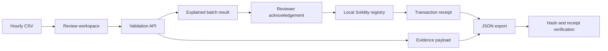

# ProofGrid product and architecture

ProofGrid turns hourly solar-generation records into explained review decisions, scoped registrations and verifiable exports. Its target user is a solar cooperative or small-project reviewer checking CSV reports before passing energy totals into an accounting workflow.

## The review workflow

| Step | Reviewer action | Product result |
|---|---|---|
| Import | Choose a meter label, capacity and hourly CSV | Display the candidate energy total and profile |
| Review | Inspect format, continuity, duplicate and capacity checks | Explain blocking issues; highlight unusual peaks for attention |
| Register | Acknowledge the reviewed evidence | Submit a real local EVM transaction; reserve its meter-hours |
| Export | Download the evidence package | Preserve the committed payload and registration details |
| Verify | Reload the package | Check content integrity, registry state and transaction receipt |

Any blocking issue stops the entire batch. The workspace retains the explanation so the source can be corrected and resubmitted. The peak-to-median comparison is a deterministic review heuristic, allowing a reviewer to inspect a plausible but unusual profile before proceeding.

## What the contract adds

A different document hash does not imply a different reporting interval. ProofGrid therefore binds two things: a hash of the reviewed evidence and the meter-hour slots represented by that evidence. A changed reading produces a new payload hash, while the existing meter-hour occupancy still prevents a repeated registration.

The contract design makes the registration rule and its transaction result inspectable through source and receipts. The implemented interface connects reviewed data, executable registration rules and verifiable transaction results.

## Architecture

The Vite/JavaScript workspace calls a local Node.js server. `server/domain.js` validates inputs and builds the ordered evidence payload with structured provenance. `server/chain.js` compiles Solidity with solc and connects ethers to an in-process Ganache EVM. `EnergyRegistry.sol` atomically records commitments and meter-hour occupancy. Verification checks the payload hash, current registry and transaction event, including receipt metadata.

## Technical specification

| Item | Current behavior |
|---|---|
| CSV schema | `timestamp,kwh`; 1–168 continuous, strictly increasing UTC hourly records |
| Energy representation | Nonnegative interval kWh, at most three decimals; total stored as integer Wh |
| Interval convention | Each timestamp labels a fixed one-hour interval; historical-fixture preparation differences cumulative source counters before import |
| Meter label | Canonical trimmed uppercase identifier, 3–32 letters/digits/hyphens; supplied by the user |
| Capacity | User-supplied kW value; one-hour kWh compared with this bound |
| Batch decision | Blocking errors reject the complete batch; warnings prompt explicit review |
| Registration key | Same meter identifier plus UTC hour in one deployed registry |
| Atomicity | A conflict rejects the complete transaction; no partial reservation |
| Evidence commitment | SHA-256 of the ordered JSON payload produced by `payloadFor`; preserve exported field order |
| Verification | Content, current contract, registered digest and matching receipt/event metadata |
| Local runtime | Loopback port 4187; session-local chain and state; no wallet extension or paid RPC needed |
| Proof meaning | Content commitment and registration of the supplied evidence in the running registry |
| Accounting role | Reviewed source-evidence packages for renewable-energy accounting workflows |

## Data demonstration

Two labelled synthetic examples exercise clean input and deliberate faults. A separate processed historical reference comes from Open Power System Data's CoSSMic household dataset, version 2020-04-15, under CC BY 4.0.

The historical sample covers 24 nominal hours on 1 June 2016, totaling **40.719 kWh**, with a **7.981 kWh** peak. The review uses a configured 10 kW setting. The transformation differences adjacent published cumulative readings. OPSD uses hourly `.last()` resampling with left labels, giving the derived intervals approximately one-minute boundary displacement. The publisher's data includes gap filling; none of the selected rows marks this PV column as interpolated.

`data/opsd-raw-selected.csv`, `data/opsd-provenance.json` and `scripts/prepare-opsd.py` preserve the selected counters, source hashes, attribution and reproducible transformation. The dataset column is a public reference label, used consistently for the reference workflow.

## Demonstrated behavior

Actual runtime checks show faulty input blocked, the historical batch reviewed and anchored, its export successfully verified, an altered export rejected, and the same 24 meter-hours rejected after values changed. Contract/API tests additionally cover atomic rejection, canonical identifiers and receipt substitution. See [the acceptance record](UI_ACCEPTANCE.md) for evidence and [the README](../README.md) for reproducible commands.

## Accounting context

The [EPA description of double counting](https://www.epa.gov/green-power-markets/double-counting) and [existing tracking systems](https://www.epa.gov/green-power-markets/energy-attribute-tracking-systems) provide the accounting context. ProofGrid connects source-data review, meter-hour registration and portable evidence verification upstream of established certificate systems.
